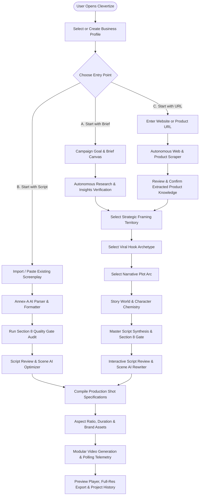

# CLEVERTIZE — VERSION 2 IMPLEMENTATION BLUEPRINT
## Phase 1: Product Architecture, UX and Technical Planning (Refined Roadmap)

**Document Status:** Refined Implementation Blueprint  
**Repository Working Directory:** `f:\Video App NEW\cleverdashboard`  
**Active Git Branch:** `redesign-v2` (Tracking `origin/redesign-v2`)  
**Version 1 Baseline Fallback:** Tag `v1-baseline` (`33bdfe64ef927e1323f51a3e86dcb5ac83138b39`) on branch `main`  
**Local Snapshot Backup:** `f:\Video App NEW\backups\cleverdashboard_baseline_20261015`  
**Automated Tests Verified:** 117 / 117 Passing (`node --test`)  
**Revision Date:** October 2026  

---

## 1. EXECUTIVE SUMMARY & PRODUCT VISION

### 1.1 Product Vision & Core Mission
Clevertize is an AI-powered creative director and video production studio engineered for small-to-medium businesses (SMBs), local retail entrepreneurs, direct-to-consumer (D2C) brands, and marketing agencies. The platform empowers any user—regardless of screenwriting or video production experience—to transform a raw business concept, website link, or pre-written script into a broadcast-quality, high-converting commercial video in minutes.

The platform eliminates the primary flaw plaguing generative video today: **"AI visual sludge"** (inconsistent faces, shifting wardrobe, morphing rooms, robotic corporate jargon, and disconnected multi-tool assembly). By embedding proven commercial filmmaking principles (the proprietary *Product Spine Framework*, Section 8 Quality Gate, single-location staging, and structured shot specification compilation), Clevertize ensures narrative discipline, cultural resonance, and visual continuity across every cut.

### 1.2 The Three Unified Entry Points
Version 2 unifies the entire creative-to-production lifecycle into three connected entry points:
1. **Journey A — Start with a Brief:** For marketers with an idea or campaign goal who want autonomous brand research, strategic angles, hook archetypes, narrative concepts, and script synthesis.
2. **Journey B — Start with an Existing Script:** For teams who already have a draft script and want instant Annex-A standardization, Section 8 Quality Gate compliance checking, AI scene optimization, and direct video production without jumping through unnecessary ideation hoops.
3. **Journey C — Start with a Website URL:** For brands who provide a homepage or product link (e.g. an e-commerce catalog or Amazon listing) and expect autonomous extraction of value propositions, customer friction points, and hero product attributes, flowing directly into strategic video production.

### 1.3 Strategic Implementation Principles
- **Preserve Verified Intellectual Property:** Retain and extend the prompt chains ([engine/creative.js](file:///f:/Video%20App%20NEW/cleverdashboard/engine/creative.js)), the Section 8 Quality Gate ([engine/gate.js](file:///f:/Video%20App%20NEW/cleverdashboard/engine/gate.js)), and the Shot Specification Compiler ([engine/compiler.js](file:///f:/Video%20App%20NEW/cleverdashboard/engine/compiler.js)).
- **Zero-Unnecessary-Dependencies:** Leverage built-in React 19 capabilities (`useReducer` + split Contexts) rather than immediately installing third-party state libraries.
- **Dependency-Aware Modularization:** Deconstruct the 3,484-line [src/App.jsx](file:///f:/Video%20App%20NEW/cleverdashboard/src/App.jsx) and 3,830-line [src/components/GuidedStudio.jsx](file:///f:/Video%20App%20NEW/cleverdashboard/src/components/GuidedStudio.jsx) using facade re-exports, ensuring that test harness assertions on file contents and exports never break.
- **Small, Independently Verifiable Milestones:** Break the roadmap into 8 sequential milestones, each with explicit scope, tests, regression risks, and rollback strategies.

---

## 2. VERIFIED CURRENT-STATE ASSESSMENT

Every statement in this section has been verified by direct static code analysis of the repository.

### 2.1 Technology Stack & Runtime Metrics
- **Frontend Core:** React 19.0.0, Vite 8.3.3, Tailwind CSS 3.4.17, Lucide React 1.52.0.
- **Backend Core:** Node.js v20+, Express 4.19.2, CORS 2.8.5, `express-rate-limit` 8.3.1 (100 req/15 min limit).
- **Test Infrastructure:** Node test runner (`node --test`), 117 tests passing across:
  - `test/engine.test.js`
  - `test/server.test.js`
  - `test/creative.test.js`
  - `test/studio.test.js`
- **Git Repository:** Remote configured to `https://github.com/Aviyrik/clevertize-video-app.git`. Active branch `redesign-v2` up to date with remote tracking.

### 2.2 Critical Codebase Realities & Architectural Deficiencies

```
Current Architecture (Verified Reality):
┌────────────────────────────────────────────────────────────────────────┐
│ FRONTEND: App.jsx (3,484 lines) + GuidedStudio.jsx (3,830 lines)       │
│ • Over 65 individual useState hooks in root App.jsx.                   │
│ • Massive prop drilling across 8 stages in a single 3,830-line file.   │
│ • State desynchronization when navigating backwards (stale downstreams)│
│ • ~1,500 lines of dead code in CreativeWorkspace.jsx imported but      │
│   never rendered in the active JSX tree.                               │
│ • VideoGenerationProgress.jsx DOES NOT EXIST on disk (embedded inline).│
└────────────────────────────────────┬───────────────────────────────────┘
                                     │ REST HTTP (JSON with Base64 Images)
┌────────────────────────────────────▼───────────────────────────────────┐
│ BACKEND: server.js (646 lines)                                         │
│ • In-Memory Session Storage: sessions = new Map()                      │
│   (All active runs and drafts lost on process restart or container redeploy)
│ • Single global plaintext password auth via HTTP Basic Auth.           │
│ • Flat JSON script store in data/scripts.json (no ACID, wipe risk).    │
└───────────────────┬────────────────────────────────┬───────────────────┘
                    │                                │
┌───────────────────▼──────────────┐   ┌─────────────▼───────────────────┐
│ AI ENGINE (Claude 3.7 Sonnet)     │   │ VIDEO ENGINE (Magnific Flow)    │
│ • engine/claude.js (58 lines)     │   │ • engine/magnific.js (274 lines)│
│ • Direct fetch, hardcoded model. │   │ • Single flow ID: 0MQyTfWvQD.   │
│ • ZERO web scraping: websiteUrl  │   │ • 1x1 transparent PNG fallback  │
│   is fed raw into prompt string. │   │   when logo/product is omitted. │
│ • No streaming, no token/cost log│   │ • Monolithic video generation.  │
└──────────────────────────────────┘   └─────────────────────────────────┘
```

1. **Monolithic State Sprawl in `App.jsx`:** [src/App.jsx](file:///f:/Video%20App%20NEW/cleverdashboard/src/App.jsx) declares over 65 individual `useState` hooks at its top level. Passing these states and their setters through hundreds of props creates re-render churn, memory leaks, and fragile reset flows.
2. **Status of `CreativeWorkspace.jsx`:** [src/components/CreativeWorkspace.jsx](file:///f:/Video%20App%20NEW/cleverdashboard/src/components/CreativeWorkspace.jsx) contains 1,840 lines of code. Code inspection confirms:
   - `CreativePanelsWorkspace`, `ResearchInsightsBanner`, `CreativeDNABar`, and `ProductionShotSpecView` are imported into [App.jsx](file:///f:/Video%20App%20NEW/cleverdashboard/src/App.jsx#L48-L53) but **never rendered** in the JSX.
   - **`SceneAIRewriteModal` IS ACTIVE** and rendered at line 3312 of `App.jsx`.
   - **Critical Test Dependency:** `test/studio.test.js:1156-1160` explicitly reads `src/components/CreativeWorkspace.jsx` via `fs.readFileSync` and asserts that `SceneAIRewriteModal`, `onApplyRewrite`, and `(e.ctrlKey || e.metaKey)` exist in the file. Blind deletion will immediately break `npm test`.
3. **Missing File Specified in Audit:** `src/components/VideoGenerationProgress.jsx` **does not exist on disk**. The video generation progress UI, polling loop, and milestone trackers are actually implemented inline inside `GuidedStudio.jsx` under `Screen08Video`.
4. **Pseudo-Research / No URL Scraping:** Code inspection of `performAdaptiveResearch` in [engine/creative.js:17-57](file:///f:/Video%20App%20NEW/cleverdashboard/engine/creative.js#L17-L57) confirms that `websiteUrl` is never fetched over HTTP, parsed, or crawled. It is merely injected into Claude's prompt string (`WEBSITE: ${site || "None"}`). Claude hallucinates marketing assumptions without seeing actual website contents, product catalogs, or Amazon listings.
5. **No Script Import or Standalone Validation:** In [server.js](file:///f:/Video%20App%20NEW/cleverdashboard/server.js) and [engine/gate.js](file:///f:/Video%20App%20NEW/cleverdashboard/engine/gate.js), `runGate` is only invoked internally during full generation pipelines. There is zero endpoint or UI to ingest, parse, or audit a pre-existing user screenplay.
6. **Zero Database / Ephemeral Volatility:** Sessions reside in an in-memory `Map()` in [server.js:31](file:///f:/Video%20App%20NEW/cleverdashboard/server.js#L31). On ephemeral container hosts (Render, Cloud Run, Railway), all active generation tracking is wiped on deployment or restart. [engine/store.js](file:///f:/Video%20App%20NEW/cleverdashboard/engine/store.js) writes to a single un-indexed JSON file (`data/scripts.json`).
7. **Single-Vendor Black-Box Video:** Video generation relies on a single hardcoded Magnific Flow (`0MQyTfWvQD`). The backend generates no scene-by-scene video clips, performs no local stitching, and uses a hardcoded 68-byte 1x1 transparent PNG data URL fallback to satisfy required flow inputs when a user does not provide product or logo images.

---

## 3. FRONTEND ARCHITECTURE & STATE MANAGEMENT EVALUATION

### 3.1 State Inventory & Dependency Classification
An inspection of `src/App.jsx` reveals 67 `useState` hooks. These states divide naturally into three distinct scopes:

| State Scope | State Variables | Lifespan & Persistence | Current Problems |
| :--- | :--- | :--- | :--- |
| **1. Global / Identity State** | `userContext` (brand name, category, town, area, logo, product), `brandResetKey`, `auth` | Persists across films; saved to `localStorage` key `clevertize_user_context`. | When a user clicks "New Film", resetting this state incorrectly wipes saved business profiles or fails to reset nested fields. |
| **2. Workflow / Studio State** | `studioStage` (1–8), `explicitChoices` (style, language, idea, opening), `creativeDNA`, `isDownstreamStale`, `staleReason`, `isGenerating` | Scoped to a single film generation session; must reset atomically on "New Film". | Changing an upstream choice (e.g. Angle in Stage 4) fails to cleanly invalidate downstream hooks, plots, and scripts, leaving mismatched drafts. |
| **3. Screen-Local State** | Active tab in Brief, suggestion chips, custom direction input text, inline scene editing buffers, rewrite modal open/close, video download error | Ephemeral to a specific screen; does not need to live at the root. | Hoisted unnecessarily into `App.jsx`, causing the entire application tree to re-render on every keystroke. |

### 3.2 Evaluation: React Native Context + Reducer vs. External Libraries (Zustand)

```
State Architecture Comparison:
┌─────────────────────────────────┬──────────────────────────────────────────┐
│ Native React 19 Context+Reducer │ External Library (Zustand / Redux)       │
├─────────────────────────────────┼──────────────────────────────────────────┤
│ ✅ Zero new npm dependencies.    │ ❌ Requires adding npm package (zustand).│
│ ✅ Built into React 19.         │ ❌ Increases bundle size & supply chain. │
│ ✅ Dispatch actions guarantee   │ ✅ Granular selector-based subscriptions │
│    atomic downstream resets.    │    (prevents some re-renders).           │
│ ✅ Split Contexts eliminate      │ ⚠️ Overkill for an 8-screen linear flow  │
│    re-render churn.             │    where only one screen shows at once.  │
└─────────────────────────────────┴──────────────────────────────────────────┘
```

#### Recommendation: Native React 19 Context + Reducer (`StudioProvider`)
For the Clevertize application, **introducing an external state library is unjustified and introduces unnecessary dependency risk**. 
Because only **one screen is visible at any given moment**, the classic Context re-render issue is negligible if state and dispatch are split:
1. `StudioStateContext`: Exposes current stage and workflow data.
2. `StudioDispatchContext`: Exposes stable action dispatchers (`dispatch({ type: 'INVALIDATE_DOWNSTREAM', stage })`, `dispatch({ type: 'RESET_STUDIO' })`).
3. Screen-local state (e.g. text field inputs, modal visibility) is moved inside each screen component via standard local `useState`.

This achieves 100% clean decoupling, atomic resets, and zero new dependencies.

---

## 4. COMPONENT MODULARIZATION & MIGRATION PLAN

### 4.1 Dependency-Aware Extraction Matrix
To safely dismantle `App.jsx` (3,484 lines) and `GuidedStudio.jsx` (3,830 lines) without breaking the test suite or introducing regressions, components must be extracted in dependency order:

```
Extraction Sequence:
Step 1: Extract SceneAIRewriteModal (Preserve CreativeWorkspace.jsx facade for tests)
Step 2: Extract Studio Navigation (StudioProgressHeader, StudioChoicesBar)
Step 3: Extract Screens 01 to 08 into src/features/studio/screens/
Step 4: Maintain GuidedStudio.jsx as an export facade
Step 5: Reduce App.jsx to an orchestrating Shell (< 200 lines)
```

| Component | Responsibility | Current Location | Dependencies to Preserve | Regression Risk & Verification |
| :--- | :--- | :--- | :--- | :--- |
| **`SceneAIRewriteModal`** | Targeted scene AI rewriter modal | `CreativeWorkspace.jsx:1611` | `scene`, `onApplyRewrite`, `onClose`, `isRewriting` | **High Test Dependency**: `test/studio.test.js:1157` checks `CreativeWorkspace.jsx` directly. **Strategy**: Keep facade re-export in `CreativeWorkspace.jsx`. |
| **`Screen01Business`** | Business profile, category, town, logo upload | `GuidedStudio.jsx:259` | `userContext`, `updateUserContext`, `handleFileUpload` | Tested by `Business Bug Tests 1-8`. Verify typing does not advance screen. |
| **`Screen02Brief`** | Campaign goal, brief textarea, suggestions | `GuidedStudio.jsx:628` | `userContext`, `updateUserContext`, `handleFileUpload` | Tested by `Brief Transition Tests 3-10`. Verify suggestion chips replace text. |
| **`Screen03Settings`** | Format, language, duration, aspect ratio | `GuidedStudio.jsx:1075` | `userContext`, `onLanguageChange`, `onStyleChange` | Tested by `Regression 3-4`. Verify explicit choices update correctly. |
| **`Screen04Idea`** | Strategic angles & custom idea input | `GuidedStudio.jsx:1512` | `directionsList`, `selectedDirection`, `onSelect` | Tested by `Studio Stage 04 Idea`. Changing idea must trigger downstream invalidation. |
| **`Screen05Opening`** | 5 Hook archetypes & custom hook input | `GuidedStudio.jsx:1729` | `hooksList`, `selectedHook`, `onSelect` | Tested by `Studio Custom Inputs`. Enter key must submit custom opening. |
| **`Screen06Story`** | 4 beats, character roster, setting | `GuidedStudio.jsx:1995` | `storyWorldData`, `constraintsList`, `avoidList` | Tested by `People & Setting cards inline editing`. Verify inline edits commit. |
| **`Screen07Script`** | Annex-A script table, inline editing, gate | `GuidedStudio.jsx:2878` | `scenes`, `setting`, `character1`, `character2` | Tested by `Studio Stage 07 Script`. Verify headline and scene rewrite triggers. |
| **`Screen08Video`** | Telemetry, polling, player, download, share | `GuidedStudio.jsx:3206` | `scenes`, `onMakeVideo`, `onNewFilm`, `videoUrl` | Tested by `Studio Stage 08 Video`. Verify Share button and New Film restart. |

### 4.2 Handling of `CreativeWorkspace.jsx`
- **Fact:** Lines 36–1610 (`ResearchInsightsBanner`, `CreativeDNABar`, `CreativePanelsWorkspace`) and lines 1753–1840 (`ProductionShotSpecView`) are completely orphaned in active application rendering.
- **Fact:** `SceneAIRewriteModal` (lines 1611–1752) is actively used and tested.
- **Rule:** Do NOT delete `CreativeWorkspace.jsx` during Phase 1 or 2. Extract `SceneAIRewriteModal` to `src/features/studio/components/SceneAIRewriteModal.jsx`, and have `CreativeWorkspace.jsx` re-export it. This ensures all 117 tests pass without modifying test assertions.
- **Deletion Condition:** Physical deletion of `CreativeWorkspace.jsx` will be scheduled as an explicitly approved, independent milestone once test suites are updated to import from new paths.

---

## 5. BASELINE REGRESSION & TEST STRATEGY

### 5.1 Existing Test Suite Inventory (117 Passing Tests)
The repository contains 117 automated unit and integration tests executing under `node --test`:
1. `test/engine.test.js` (24 tests): Tests core parsing, festival calendar, prompt substitutions, Section 8 gate rules, and compiler continuity locks.
2. `test/server.test.js` (14 tests): Tests Express endpoints (`/api/run`, `/api/status`, `/api/download`), rate limits, input sanitization, and fallback 1x1 transparent PNG injection.
3. `test/creative.test.js` (15 tests): Tests Claude prompt chains, research synthesis, angle generation, hook archetypes, plot synthesis, and scene rewrites.
4. `test/studio.test.js` (64 tests): Tests Guided Studio state transitions, regression behaviors (Regression 1–8), business bug typing protections (Tests 1–8), brief fallbacks (Tests 3–10), and custom entry shortcuts.

### 5.2 Feature Coverage & Gap Analysis
| Workflow Behavior | Existing Test Coverage | Status | Required Action / Proposed Test |
| :--- | :--- | :--- | :--- |
| **New Film Reset** | `Regression 6`, `Business Bug Test 6`, `Studio Reset` | ✅ VERIFIED | Require tests to pass after state refactor. |
| **Stage Transitions (1 to 8)** | `Guided Studio V4 Architecture: 8 Stages` | ✅ VERIFIED | Ensure extracted screen components maintain stage IDs. |
| **Back/Forward Navigation** | `Studio Stale Warning`, `Regression 8` | ✅ VERIFIED | Verify downstream state is invalidated when upstream changes. |
| **Stale Decision Clearing** | `Studio Stage 04 Idea: Changing Idea invalidates` | ✅ VERIFIED | Test atomic clearing of hooks/script when angle changes. |
| **Script Generation & Gate** | `synthesizeMasterScript`, `Quality gate rejects` | ✅ VERIFIED | Retain all gate checks in `engine/gate.js`. |
| **Shot Spec Compilation** | `compileShotSpecification`, `Annex A formatting` | ✅ VERIFIED | Retain compiler logic in `engine/compiler.js`. |
| **Video Run & Status Polling** | `server.test.js: approve saves; run strips` | ✅ VERIFIED | Ensure Magnific polling loop is unaffected. |
| **Transparent PNG Fallback** | `Magnific explicitInputs: Always satisfies logo` | ✅ VERIFIED | Keep 1x1 fallback in place until S3 asset uploads exist. |
| **Script Ingestion (Journey B)** | *None (Feature does not exist yet)* | ❌ MISSING | **NEW TEST REQUIRED**: `test/ingest.test.js` to validate script text parsing and gate audit. |
| **URL Scraping (Journey C)** | *None (Feature does not exist yet)* | ❌ MISSING | **NEW TEST REQUIRED**: `test/scraper.test.js` to test OpenGraph & metadata extraction. |

### 5.3 Non-Negotiable Regression Rule
After **every single milestone**, `npm test` (`cmd.exe /c npm test`) must execute and pass all 117 tests with 0 failures before any code can be merged or advanced to the next milestone.

---

## 6. PRODUCT INFORMATION ARCHITECTURE & VISUAL DIRECTION

### 6.1 Visual Design Philosophy
The redesigned UI must convey a **premium, restrained, professional creative studio aesthetic**:
- **Canvas:** Subtle deep-slate gradient background (`#0B0F17` to `#111827`) with soft ambient lighting, avoiding loud generic purple AI SaaS gradients.
- **Navigation:** Translucent frosted-glass left sidebar (`backdrop-blur-md bg-white/[0.03] border-r border-white/[0.08]`).
- **Cards & Controls:** Subtle 1px borders, restrained rounded corners (`rounded-xl`), and crisp typography (Inter / SF Pro Display). Eliminate repetitive, bubbly dashboard widgets.
- **Prominent Video Workspace:** Stages 6 and 7 feature high-contrast, large-format visual storyboards and embedded preview players with dedicated focus modes.

### 6.2 Screen Hierarchy
```
┌────────────────────────────────────────────────────────────────────────────────────────┐
│ GLOBAL STUDIO NAVIGATION SHELL                                                         │
│ Top Bar: Brand Switcher (Active Client) | Active Entry Mode Badge | Choice DNA Drawer   │
├───────────────────────────────┬────────────────────────────────────────────────────────┤
│ LEFT WORKSPACE NAV (Translucent)│ MAIN CREATIVE CANVAS (Adaptive Gradient)              │
│                               │                                                        │
│ • Business & Brand Profiles   │ [DYNAMIC STAGE WORKSPACE]                              │
│ • Entry Mode Selector         │ Stage 1: Brand & Campaign Setup                        │
│   - Mode A: Brief Canvas      │ Stage 2: Knowledge & Insights (Verified Extraction)    │
│   - Mode B: Script Importer   │ Stage 3: Strategic Angles & Hook Selection             │
│   - Mode C: URL Analyzer      │ Stage 4: Narrative Plot & Story World Architecture     │
│ • Active Project Drafts       │ Stage 5: Screenplay Studio & Section 8 Gate Inspector  │
│ • Video Production Queue      │ Stage 6: Production Staging (Shots, Assets, Ratio)     │
│ • Deliverables Archive        │ Stage 7: Video Render & Master Delivery Hub            │
│ • Account & Model Settings    │                                                        │
├───────────────────────────────┴────────────────────────────────────────────────────────┤
│ COLLAPSIBLE INSPECTOR DRAWER (Right)                                                   │
│ • Annex-A Live Script | Section 8 Scorecard | Shot Specifications | Asset Previews     │
└────────────────────────────────────────────────────────────────────────────────────────┘
```

---

## 7. THREE ENTRY-POINT USER JOURNEYS



### 7.1 Journey A: Start with a Brief
1. **Business Setup:** User selects an existing brand profile or creates one (capturing brand name, category, town, tone).
2. **Brief Canvas:** User describes campaign goals in conversational sentences or selects category-aware suggestion chips.
3. **Research Insights:** System displays extracted consumer desires, category clichés to avoid, and competitive white space.
4. **Strategic Angles:** System generates 3 distinct strategic territories. User locks their preferred angle.
5. **Hook Selection:** System provides 5 hook formulas (Negative Inversion, Curiosity Loop, etc.). User selects a hook.
6. **Narrative Concepts:** System generates 3 plot arcs with dramatic questions. User selects a concept.
7. **Story World Architecture:** Locks continuous room setting and 2 characters across 4 narrative beats.
8. **Master Script Synthesis:** Synthesizes Annex-A script and enforces Section 8 Quality Gate.
9. **Script Studio:** Interactive review, inline dialogue editing, and Scene AI Rewriter modal.
10. **Production Staging:** Validates shot specifications, aspect ratio (9:16 / 16:9), and optional asset uploads.
11. **Video Generation:** Dispatches to cloud GPU pipeline with live status telemetry.
12. **Master Delivery:** In-app playback, 1080p MP4 download, web share, and project library archive.

### 7.2 Journey B: Start with an Existing Script
1. **Business Linkage:** User selects brand profile to link logo and brand context.
2. **Script Ingestion Canvas:** User pastes raw screenplay text or uploads a `.txt` / `.fdx` file.
3. **Standardization Parser:** Backend normalizes the text into 4 Annex-A scenes (Visual, Dialogue, Camera, SFX).
4. **Standalone Quality Gate Audit:** `POST /api/script/audit` evaluates the script against the 18 Section 8 rules (dialogue pacing under 3 words/sec, continuous setting, prohibited tropes).
5. **Interactive Script Optimizer:** Displays a line-by-line scorecard with 1-click "Auto-Fix with AI" buttons for failing scenes.
6. **Production Compilation:** Compiles approved script into structured shot specifications.
7. **Video Dispatch & Delivery:** Selects aspect ratio, triggers GPU generation, and delivers final video.

### 7.3 Journey C: Start with a Website URL
1. **URL Submission:** User inputs a homepage, e-commerce catalog, or Amazon listing URL.
2. **Autonomous Scraper:** Backend extracts OpenGraph metadata, product titles, bullet features, and hero images.
3. **Knowledge Review Card:** User reviews and confirms extracted product details (Product Name, Key Features, Audience).
4. **Direct Angle Synthesis:** Creative engine synthesizes 3 strategic territories directly from verified product specs.
5. **Creative Flow:** Seamlessly proceeds into Hook selection (Journey A, Steps 5–12) with pre-populated product assets.

---

## 8. SCREEN-BY-SCREEN UX SPECIFICATIONS

```
Screen Flow Hierarchy:
[Screen 1: Business & Entry Hub] ──┬──> [Screen 2A: Brief Canvas] ────┐
                                   ├──> [Screen 2B: Script Importer] ─┼──> [Screen 3: Insights & Angle Selection]
                                   └──> [Screen 2C: URL Analyzer] ────┘          │
                                                                                 ▼
                                                                     [Screen 4: Concept & Story World]
                                                                                 │
                                                                                 ▼
                                                                     [Screen 5: Screenplay Studio & QA Gate]
                                                                                 │
                                                                                 ▼
                                                                     [Screen 6: Production Staging]
                                                                                 │
                                                                                 ▼
                                                                     [Screen 7: Video Render & Delivery Hub]
```

- **Screen 1: Business Hub & Entry Mode Selector:** Brand profile switcher + 3 entry mode cards (*Brief*, *Script*, *URL*).
- **Screen 2: Dynamic Input Canvas:** Mode A (Brief + category chips); Mode B (Script paste/upload); Mode C (URL input + live DOM extraction).
- **Screen 3: Insights & Strategic Angles:** Tabbed research insights (Audience Truths, Clichés, Opportunities) + 3 territory cards.
- **Screen 4: Narrative Concept & Story World:** 5 Hook archetypes + 3 narrative plot cards + 4-beat story world preview.
- **Screen 5: Screenplay Studio & Section 8 Gate:** 4-scene Annex-A table with inline text editing, Scene AI Rewriter, and live Quality Gate scorecard drawer.
- **Screen 6: Production Staging & Asset Studio:** Aspect ratio selector (9:16 / 16:9 / 1:1), duration selector, product/logo upload slots, and compiled shot specification inspector.
- **Screen 7: Video Render & Master Delivery Hub:** Real-time production milestone bar, HTML5 preview player, 1080p download button, share dialog, and "Start Another Film" button.

---

## 9. REVISED PHASED IMPLEMENTATION ROADMAP (MILESTONES 1 TO 8)

The roadmap is strictly organized into 8 sequential milestones designed for minimum regression risk and maximum testability:

```mermaid
gantt
    title Clevertize V2 Refined Milestone Sequence
    dateFormat  YYYY-MM-DD
    section Phase 1: Stabilization & Architecture
    Milestone 1: Architecture Verification & Test Harness    :m1, 2026-10-16, 2d
    Milestone 2: Frontend State Stabilization (Context)      :m2, after m1, 3d
    Milestone 3: Design System Tokens & Base Primitives      :m3, after m2, 3d
    Milestone 4: Application Shell & Workflow Decoupling    :m4, after m3, 4d
    section Phase 2: Persistence & Journeys
    Milestone 5: Auth, Business Profiles & DB Persistence    :m5, after m4, 4d
    Milestone 6: URL Research Scraper & Script Ingestion     :m6, after m5, 4d
    section Phase 3: AI & Video Upgrades
    Milestone 7: Multi-Provider AI Abstraction               :m7, after m6, 3d
    Milestone 8: Video Generation Reliability & Telemetry    :m8, after m7, 4d
```

---

### MILESTONE 1: Architecture Verification and Regression Protection
- **Objective:** Establish automated regression safeguards for the existing application before any refactoring begins.
- **Exact Scope:**
  - Audit existing 117 tests in `test/studio.test.js`, `test/creative.test.js`, `test/server.test.js`, and `test/engine.test.js`.
  - Add test harness assertions verifying that `App.jsx` and `GuidedStudio.jsx` export structures match required entry points.
  - Verify that the local backup snapshot at `F:\Video App NEW\backups\cleverdashboard_baseline_20261015` is fully intact and recoverable.
- **Files Expected to Change:** `test/studio.test.js` (additive regression test assertions only).
- **Dependencies:** None.
- **Tests to Run:** `cmd.exe /c npm test` (117+ tests).
- **Acceptance Criteria:** All existing tests pass; test execution time remains under 2 seconds; baseline integrity documented.
- **Potential Regressions:** None (read-only verification + additive tests).
- **Rollback Strategy:** `git checkout HEAD -- test/`.
- **Explicitly Excluded Work:** Do not touch application code, UI layouts, or engine prompts.

---

### MILESTONE 2: Incremental Frontend Modularization and State Stabilization
- **Objective:** Eliminate the 65+ `useState` sprawl in `src/App.jsx` and modularize `GuidedStudio.jsx` into testable screen components without introducing external state libraries.
- **Exact Scope:**
  - Implement native React 19 `StudioContext` and `StudioDispatchContext` with a clean `studioReducer`.
  - Extract Screens 01 to 08 into individual files in `src/features/studio/screens/`:
    - `Screen01Business.jsx`
    - `Screen02Brief.jsx`
    - `Screen03Settings.jsx`
    - `Screen04Idea.jsx`
    - `Screen05Opening.jsx`
    - `Screen06Story.jsx`
    - `Screen07Script.jsx`
    - `Screen08Video.jsx`
  - Maintain `src/components/GuidedStudio.jsx` as a **facade re-exporter** for the extracted screens so `test/studio.test.js` file-read assertions do not break.
  - Extract `SceneAIRewriteModal` to `src/features/studio/components/SceneAIRewriteModal.jsx`, and maintain a re-export in `CreativeWorkspace.jsx` to satisfy `test/studio.test.js:1157`.
  - Fix the "New Film" button permanently via an atomic `RESET_STUDIO` action that clears draft copy while preserving the saved brand profile.
  - Implement atomic downstream invalidation: changing an Idea in Stage 4 dispatches `INVALIDATE_DOWNSTREAM`, clearing stale hooks and scripts.
- **Files Expected to Change:**
  - `src/context/StudioContext.jsx` (New)
  - `src/features/studio/screens/*.jsx` (New modular screens)
  - `src/components/GuidedStudio.jsx` (Facade re-exporter)
  - `src/components/CreativeWorkspace.jsx` (Maintain facade for SceneAIRewriteModal)
  - `src/App.jsx` (Streamlined to consume `StudioProvider`)
- **Dependencies:** Milestone 1 completion.
- **Tests to Run:** `cmd.exe /c npm test` (All 117 tests must pass).
- **Acceptance Criteria:**
  - `App.jsx` length reduced significantly.
  - Zero state-closure bugs when clicking "New Film" or changing an Idea.
  - Zero console errors or undeclared variable references.
  - All 117 tests pass with 0 regressions.
- **Potential Regressions:** Missing prop in an extracted screen causing a blank render.
- **Rollback Strategy:** Revert to commit tag `v1-baseline` or restore from local backup snapshot.
- **Explicitly Excluded Work:** Do not redesign visual layouts or change styling yet; preserve existing JSX structures.

---

### MILESTONE 3: Product Information Architecture and New Design System
- **Objective:** Implement the premium design tokens, color palette, and reusable UI primitives without breaking workflow logic.
- **Exact Scope:**
  - Define design tokens in `tailwind.config.js` or `index.css`: deep slate canvas gradients, frosted-glass borders, translucent backdrops, and typography hierarchy.
  - Create reusable primitive components in `src/shared/`:
    - `StudioButton.jsx` (Primary, Secondary, Ghost, Danger with subtle sheen).
    - `StudioCard.jsx` (Interactive selection cards with subtle active borders).
    - `StudioInput.jsx` / `StudioTextarea.jsx` (Focus rings, character counters).
    - `StudioBadge.jsx` (Status badges for categories and formats).
    - `StudioModal.jsx` (Accessible modal wrapper).
- **Files Expected to Change:** `src/shared/*.jsx`, `src/index.css`.
- **Dependencies:** Milestone 2 completion.
- **Tests to Run:** `cmd.exe /c npm test`.
- **Acceptance Criteria:** Primitives render cleanly in isolation; existing screens visually adopt the new tokens without layout breakage.
- **Potential Regressions:** CSS specificity collisions or broken button onClick handlers.
- **Rollback Strategy:** `git checkout HEAD -- src/shared/ src/index.css`.
- **Explicitly Excluded Work:** Do not alter workflow stage sequence or API request shapes.

---

### MILESTONE 4: New Application Shell and Unified Workflow
- **Objective:** Deploy the new global studio shell (translucent sidebar, top bar, dynamic entry-point picker).
- **Exact Scope:**
  - Build `StudioLayout.jsx` with the persistent top context bar (active brand pill, entry mode badge, auto-save status).
  - Build the frosted-glass left navigation containing:
    - Business Profile Switcher Drawer.
    - Prominent "New Film" button (calling `RESET_STUDIO`).
    - Campaign History link.
  - Build Screen 1 Entry Point Selector:
    - Card A: *Start with a Brief*
    - Card B: *Start with an Existing Script*
    - Card C: *Start with a Website URL*
  - Build the collapsible Right Inspector Drawer for Annex-A live script preview and Section 8 Gate audit scorecard.
- **Files Expected to Change:** `src/features/studio/StudioLayout.jsx`, `src/features/studio/screens/Screen01Hub.jsx`, `src/App.jsx`.
- **Dependencies:** Milestones 2 & 3 completion.
- **Tests to Run:** `cmd.exe /c npm test`.
- **Acceptance Criteria:** User can toggle between entry points; sidebar navigates smoothly; "New Film" restarts cleanly; right drawer opens/collapses without jitter.
- **Potential Regressions:** Z-index layering issues with modals or navigation drawers.
- **Rollback Strategy:** Revert `StudioLayout.jsx` and `App.jsx` changes.
- **Explicitly Excluded Work:** Backend database integration or real URL scraping.

---

### MILESTONE 5: Authentication, Business Profiles and Persistent Projects
- **Objective:** Introduce production database persistence, multi-brand switching, and permanent campaign project history.
- **Exact Scope:**
  - Initialize PostgreSQL schema with Prisma ORM: `User`, `Business`, `Project`, `VideoRun`.
  - Implement JWT / session authentication routes: `/api/auth/signup`, `/api/auth/login`, `/api/auth/me`.
  - Implement business profile CRUD: `/api/business` (multi-brand support per user).
  - Implement project auto-save: `/api/projects/save-draft` and `/api/projects/:id`.
  - Replace Base64 image JSON transmissions with presigned direct-to-S3/R2 uploads (passing clean URLs to the backend).
  - Build `ProjectLibrary.jsx` screen displaying saved drafts and generated video exports.
- **Files Expected to Change:** `prisma/schema.prisma`, `server/routes/`, `server/controllers/`, `src/features/library/`, `src/features/business/`.
- **Dependencies:** Milestone 4 completion.
- **Tests to Run:** `cmd.exe /c npm test` + new database CRUD integration tests.
- **Acceptance Criteria:**
  - Server restarts do not wipe active projects or user sessions.
  - Users can switch between multiple brand profiles with 1 click.
  - Large image uploads succeed without exceeding Node.js memory limits.
- **Potential Regressions:** Database connection timeout or migration failure on deployment.
- **Rollback Strategy:** Maintain existing in-memory/localStorage fallback mode via environment variable toggle `USE_DB=false`.
- **Explicitly Excluded Work:** AI provider switching or custom scraper development.

---

### MILESTONE 6: URL Research Scraper and Script Ingestion (Journeys B & C)
- **Objective:** Deliver true web/product research (Journey C) and standalone script ingestion/audit (Journey B).
- **Exact Scope:**
  - **Journey B (Script Ingestion):**
    - Expose `POST /api/script/audit` to run Section 8 Gate on pre-written scripts.
    - Implement `Screen02ScriptImport.jsx` with raw text paste, FDX upload, and line-by-line gate scorecard display.
  - **Journey C (URL Scraper):**
    - Build server-side scraper worker using Cheerio for OpenGraph, meta tags, and schema.org product data.
    - Build Amazon product parser extracting product title, key bullet points, and customer review sentiment.
    - Implement `Screen02UrlAnalyzer.jsx` displaying the structured Knowledge Review card for user verification.
    - Feed verified product knowledge directly into creative angle generation.
- **Files Expected to Change:** `engine/scraper.js` (New), `server/routes/script.routes.js`, `src/features/studio/screens/Screen02ScriptImport.jsx`, `src/features/studio/screens/Screen02UrlAnalyzer.jsx`.
- **Dependencies:** Milestone 5 completion.
- **Tests to Run:** `cmd.exe /c npm test` + new scraper unit tests with mocked HTML fixtures.
- **Acceptance Criteria:**
  - Pasting an existing script immediately produces an 18-point Section 8 compliance audit.
  - Pasting a valid product URL extracts title, price, and features into the review card within 5 seconds.
  - Anti-bot blocks (e.g. Amazon CAPTCHA) fail gracefully with helpful manual fallback fields.
- **Potential Regressions:** HTTP timeout or unhandled DOM structure on unusual websites.
- **Rollback Strategy:** Disable URL scraper route; fallback to manual brief entry.
- **Explicitly Excluded Work:** Multi-model LLM abstraction.

---

### MILESTONE 7: AI Provider Abstraction and Model Selection
- **Objective:** Decouple the creative engine from hardcoded Claude calls and provide user-friendly model selection.
- **Exact Scope:**
  - Create `BaseAIProvider` class with standardized methods: `generateText()` and `generateJSON()`.
  - Implement provider adapters:
    - `ClaudeProvider.js` (Claude 3.7 Sonnet).
    - `OpenAIProvider.js` (GPT-4o with structured JSON schema outputs).
    - `GeminiProvider.js` (Gemini 2.0 Flash / Pro).
  - Add simple user-facing model picker in Studio Settings ("Claude 3.7 — Creative & Emotional", "GPT-4o — Fast & Punchy", "Gemini 2.0 Flash — Ultra Fast").
  - Add `AIUsageLog` database logging for tokens, latency, and estimated cost per generation.
- **Files Expected to Change:** `engine/ai/` (New directory), `engine/creative.js`, `src/features/settings/ModelSelector.jsx`.
- **Dependencies:** Milestone 6 completion.
- **Tests to Run:** `cmd.exe /c npm test` + provider mock tests.
- **Acceptance Criteria:**
  - Creative prompts execute identically across Claude, GPT-4o, and Gemini.
  - Token consumption and latency are recorded in the database.
  - Switching models in UI updates generation execution seamlessly.
- **Potential Regressions:** JSON schema formatting discrepancies between Anthropic and OpenAI.
- **Rollback Strategy:** Revert model router to default to `ClaudeProvider`.
- **Explicitly Excluded Work:** Scene-by-scene video rendering.

---

### MILESTONE 8: Video Generation Reliability and Production Improvements
- **Objective:** Upgrade video production telemetry, enhance Magnific Flow reliability, and prepare modular scene-level rendering.
- **Exact Scope:**
  - Upgrade Magnific adapter: move polling from client `setInterval` to a backend task runner with Server-Sent Events (SSE) streaming progress to the client.
  - Replace the 68-byte transparent PNG workaround with genuine product and logo image bindings from S3 storage.
  - Add detailed production telemetry milestones ("Rendering Scene 1/4...", "Synthesizing Camera Motion...", "Finalizing Composite...").
  - Implement full-screen HTML5 video preview player with loop controls, 1080p MP4 download proxy, and native mobile share sheet.
  - Prototype scene-by-scene video generation interface and ElevenLabs TTS audio synthesis.
- **Files Expected to Change:** `engine/video/` (New directory), `server/routes/video.routes.js`, `src/features/studio/screens/Screen07Delivery.jsx`.
- **Dependencies:** Milestone 7 completion.
- **Tests to Run:** `cmd.exe /c npm test` + video status polling tests.
- **Acceptance Criteria:**
  - Video production progress bar smoothly reflects real backend milestones.
  - Final video renders play reliably in-browser and download at full resolution.
  - Network disconnections during video generation do not lose the job run ID.
- **Potential Regressions:** Third-party Magnific API rate limiting or timeout.
- **Rollback Strategy:** Fallback to standard HTTP polling if SSE stream encounters network proxy issues.
- **Explicitly Excluded Work:** Full custom FFmpeg cluster deployment (kept as future enhancement).

---

## 10. COMPREHENSIVE RISK REGISTER

| # | Risk Description | Severity | Likelihood | Impact on Product | Concrete Mitigation Strategy |
| :- | :--- | :--- | :--- | :--- | :--- |
| **R1** | **Breaking Existing Test Harness File-Reads** | CRITICAL | HIGH | `test/studio.test.js` uses `fs.readFileSync` on `App.jsx`, `GuidedStudio.jsx`, and `CreativeWorkspace.jsx`. Deleting or moving them breaks tests immediately. | Maintain `GuidedStudio.jsx` and `CreativeWorkspace.jsx` as facade re-exporters for all extracted components until test harness is updated. |
| **R2** | **Server Memory Crash from Base64 Payloads** | CRITICAL | HIGH | Sending multiple high-res product and logo photos as Base64 strings inside JSON payloads exhausts Node.js heap memory. | Transition immediately in Milestone 5 to direct client-to-S3/R2 presigned URL uploads. |
| **R3** | **Ephemeral Cloud State Loss** | CRITICAL | HIGH | In-memory `sessions` Map and `data/scripts.json` are wiped whenever cloud hosts restart or deploy. | Implement PostgreSQL database with Prisma ORM in Milestone 5; decouple session storage from process memory. |
| **R4** | **Amazon Anti-Bot Scraping Blocks** | HIGH | HIGH | Scraping Amazon product listings directly via HTTP requests triggers CAPTCHA and 403 Forbidden errors. | Use structured meta parsing (OpenGraph/JSON-LD) and fallback gracefully to user manual entry with clear guidance. |
| **R5** | **Third-Party Video Flow Single Point of Failure** | HIGH | MEDIUM | If Magnific changes flow ID `0MQyTfWvQD` or updates required input keys, video generation halts entirely. | Decouple flow input keys into environment variables; validate flow spec dynamically; prepare multi-provider fallback. |
| **R6** | **Frontend State Desynchronization** | HIGH | MEDIUM | Backwards navigation in wizard leaves downstream ideas or script text mismatched with newly selected angles. | Implement atomic downstream invalidation in `StudioContext` reducer (`INVALIDATE_DOWNSTREAM`). |
| **R7** | **API Rate Limits & Latency Timeouts** | MEDIUM | MEDIUM | Master script synthesis takes 35-45 seconds; concurrent users can hit Claude rate limits. | Implement BullMQ asynchronous task queue with exponential backoff and client progress streaming via SSE. |

---

## 11. ASSUMPTIONS & UNRESOLVED QUESTIONS

### 11.1 Verified Facts vs. Assumptions
- **Verified Fact:** Current video generation relies strictly on Magnific Flow `0MQyTfWvQD` via [engine/magnific.js](file:///f:/Video%20App%20NEW/cleverdashboard/engine/magnific.js).
- **Verified Fact:** Current AI generation uses Claude Sonnet via direct fetch in [engine/claude.js](file:///f:/Video%20App%20NEW/cleverdashboard/engine/claude.js).
- **Verified Fact:** Current research performs zero URL scraping; it feeds raw text into Claude prompts.
- **Verified Fact:** `SceneAIRewriteModal` in `CreativeWorkspace.jsx` is actively used in `App.jsx` and tested in `test/studio.test.js`.
- **Assumption:** S3-compatible object storage (AWS S3 or Cloudflare R2) and a PostgreSQL database will be provisioned for Milestone 5.
- **Assumption:** The target video output duration remains focused primarily on 15s to 30s social ad formats (Reels, Shorts, TikTok).

### 11.2 Key Questions Requiring Human Strategic Decisions
1. **Database & Infrastructure Hosting Preference:**
   - Does the team prefer a fully managed backend (e.g., **Supabase** for PostgreSQL + Auth + Storage), or a self-hosted architecture (dedicated PostgreSQL on RDS/Railway + AWS S3 / Cloudflare R2)?
2. **Scraping Infrastructure for Amazon URLs:**
   - Amazon vigorously defends against standard HTTP scrapers with CAPTCHAs. Should the platform integrate a dedicated e-commerce scraping API (e.g., **Rainforest API** or **BrightData**) for guaranteed Amazon ASIN parsing, or rely on a headless Chromium (Puppeteer) worker with proxy rotation?
3. **Video Production Strategy:**
   - In Milestone 8, should the platform prioritize **Scene-by-Scene Generation + FFmpeg Assembly** (grants users granular scene regeneration and exact audio sync, but requires video worker servers), or continue using **All-in-One Cloud Flows** (zero server video infrastructure, but black-box outputs)?
4. **AI Model Selection Policy:**
   - Should end users have explicit model selection dropdowns (e.g., choosing between Claude 3.7 and GPT-4o), or should model routing be handled autonomously by the backend to optimize quality and cost per stage?

---
*End of Blueprint. Implementation will commence only upon explicit human approval of this blueprint and Milestone 1 authorization.*
